  

  

### Olá, seja bem-vindo!

Sou **Raul Fabiano**. Gosto de resolver problemas reais com tecnologia, escrever código com propósito e aprender continuamente.

Neste espaço, compartilho projetos, ideias e minha evolução na tecnologia.

 

---

Aprender, construir e evoluir — um projeto de cada vez.

