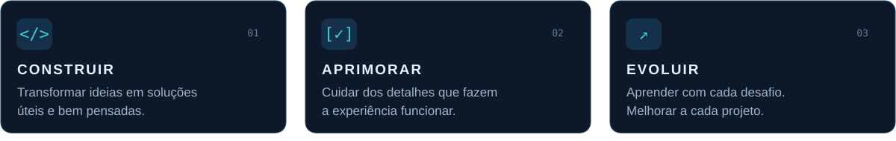

  

  
  &nbsp;
  
  &nbsp;
  

 

### `01` / Por trás do código

Sou **Raul Fabiano**. Gosto de resolver problemas reais com tecnologia e dar forma a ideias que tenham utilidade no dia a dia.

**Meu jeito de trabalhar:** entender o problema, construir com propósito e melhorar os detalhes. Este perfil reúne projetos, experimentos e aprendizado em prática.

 

 

### `02` / Sempre em construção

> **Do primeiro rascunho ao último ajuste.**  
> Cada projeto é uma oportunidade de testar ideias, aprender e entregar algo melhor.

Explore os **[repositórios](https://github.com/Raul-Fabiano-Dev?tab=repositories)** e os projetos fixados abaixo.

 

---

  <b>RAUL FABIANO</b> &nbsp; / &nbsp; Curiosidade para aprender. Propósito para construir.

